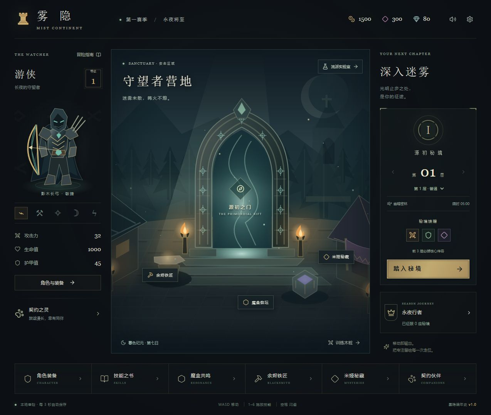

# 雾隐 · Mist Continent

本地运行的黑暗幻想自动战斗 ARPG。使用 React 19、TypeScript、Vite、PixiJS v8、Zustand 与 Web Audio，不需要账号、后端服务或外部图片和音频资源。



## 启动

需要 Node.js 22.12+ 和 pnpm。

```sh
pnpm install
pnpm dev
```

打开终端打印的本机地址，默认为 `http://127.0.0.1:5173/`。第一次点击或按键后启用音频。项目的 `pnpm-workspace.yaml` 仅允许 esbuild 的安装脚本。

```sh
pnpm typecheck
pnpm test
pnpm build
```

构建产物在 `dist/`，可部署到静态服务器。不要直接通过 `file://` 打开构建文件。运行时无需网络；首次安装依赖需要连接 npm 仓库。

## 操作

- WASD / 方向键、拖动战场、虚拟摇杆或手柄左摇杆移动。
- 1–6 或点击技能图标施放技能；空格施放位移；Escape 暂停。
- 每个技能分别切换 AUTO / 手动，默认位移手动。
- 秘境按钮选择已解锁层数，300 秒内击败守关首领。拾取精英进度球召唤首领，靠近圣坛后点击激活。
- 设置和战斗右侧按钮可切换横竖屏；设置支持音量、静音和低品质自动分解。

## 内容与成长

配置含 5 职业、75 技能节点、15 职业套装、45 传奇、24 小怪、8 首领、10 精英词缀、150 层秘境、4 地貌、4 圣坛、5 色10阶宝石与6种宠物。

营地提供角色与背包、技能树、三槽魔盒、部位秘藏单抽/十连、装备分解/洗练/槽位神铸、宝石合成镶嵌、宠物升级和本地赛季任务。太古装备使用上限130%的属性与满值传奇效果。魔盒和身上同名传奇仅生效一次。

流派实验室提供15套成型配装。体验期间使用独立内存副本，自动保存和导出仍保存原有开荒档；点击“结束体验，返回开荒”恢复原进度。演武场不发放收益。远征榜记录本地前20次通关的配装，可在隔离的演武存档中体验历史配装；没有在线排行榜或联机服务。

## 存档

每3秒写入 IndexedDB，页面退出时补写浏览器备份；IndexedDB 不可用时退回 localStorage。离线收益最多累计8小时。设置中可以导出和导入 JSON，导入前会检查版本、数值、装备ID、部位、技能与魔盒配置。无效旧档会保留原始恢复副本，可在设置中导出。

存档属于当前浏览器和站点地址。切换端口、浏览器或清除站点数据可能导致读不到原档，请先导出。存档文件应自行保管；没有服务器恢复功能。

## 工程结构

| 目录 | 作用 |
| --- | --- |
| `src/data` | 完整职业、技能、装备、怪物与秘境数据 |
| `src/core` | 类型约定、大数格式化与可重现随机数 |
| `src/engine` | 战斗、怪物AI、投射物、掉落、圣坛 |
| `src/render` | 复用的角色纸娃娃、怪物、地图、特效与跳字 |
| `src/audio` | 28种合成音效与3种生成式配乐 |
| `src/state` | 成长、交易、存档与演武隔离 |
| `src/ui` | 城镇、系统弹窗、装备预览与触控输入 |
| `tests` | 数据完整性、伤害/掉落、交易守恒、存档、流派与怪物行为测试 |

Vite 的依赖预构建通过 Node 写入缓存，兼容 Windows 受管工作区中原生 esbuild 不能直接写缓存的环境。生产构建仍使用标准 Vite 流程。`pnpm format` 统一源码格式。

伤害超出安全整数范围时使用 BigInt 整数比例连乘并统一舍入；实时生命值与渲染仍用 Number，大数显示为万/亿/兆/京。精确结算入口为 `calculateExactDamage`。

程序化图形与合成音乐为本项目实现。配置按所提供规格编写；这不是原游戏官方客户端，不含其素材资源。商业级视觉、精确的原作行为一致性和所有设备稳定60fps，需要独立的美术与性能验收，不能仅以构建通过视为已经认证。
