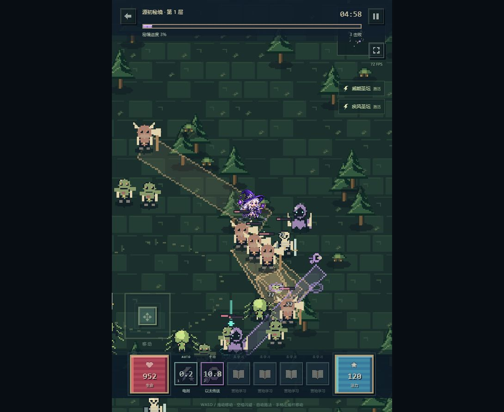

# 雾隐 · Mist Continent

黑暗幻想自动战斗 ARPG，含可走动的 NPC 服务大厅、真实在线角色展示和五职业独立战绩榜。前端使用 React 19、TypeScript、Vite、PixiJS v8、Zustand 与 Web Audio；后端使用 Fastify、SQLite，提供服务器注册登录与跨设备云存档，也保留本地访客玩法。角色图片随项目打包，音频本地合成。



## 启动

需要 Node.js 22.18+（服务器推荐24 LTS）和 pnpm。

```sh
pnpm install
pnpm dev
```

打开终端打印的本机地址，默认为 `http://127.0.0.1:5173/`。第一次点击或按键后启用音频。项目的 `pnpm-workspace.yaml` 仅允许 esbuild 的安装脚本。

另开一个终端运行 `pnpm server:dev` 启动默认3001端口的API。前端开发服务器已代理 `/api`，无需另设跨域服务。在营地“账号与角色”中注册或登录：新云账号可以迁移当前本地账号或创建新档；已有云档可在另一设备登录后载入。单个服务器账号最多6角色，账号归属和容量均由服务端校验。

生产部署、HTTPS、环境变量、数据库备份与恢复见 [服务器部署指南](docs/SERVER.md)。仓库附带 Dockerfile、Compose 和 Caddy 配置；部署时需要实际服务器与域名。

```sh
pnpm typecheck
pnpm test
pnpm build
```

构建产物在 `dist/`，生产后端可同源提供前端和API。单独部署静态文件仅支持访客本地存档。不要通过 `file://` 打开构建文件。服务器认证与云同步需要网络，掉线时进度保留在当前设备。

## 操作

- 大厅用 WASD / 方向键、摇杆或点击地面走动；点击 NPC 自动走近，靠近后按 E 或点击交互，进入装备、技能、铁匠、秘藏、魔盒、伙伴、仓库与榜单。
- 战斗中 WASD / 方向键、拖动战场、虚拟摇杆或手柄左摇杆移动。
- 1–6 或点击技能图标施放技能；空格施放位移；Escape 暂停。
- 每个技能分别切换 AUTO / 手动，默认位移手动；战斗内修改也会保存。冷却或缺能会显示原因。
- 新角色自动打开分步教程；营地右上角可随时重看。手机底部固定提供装备、技能、出征、职业榜和全部服务入口。
- 秘境按钮选择已解锁层数，300 秒内击败守关首领。拾取精英进度球召唤首领，靠近圣坛后点击激活。
- 设置和战斗右侧按钮可切换横竖屏；设置支持音量、静音和低品质自动分解。

## 内容与成长

每个账号最多创建6个角色（允许同职业），创建后职业固定。等级、技能、装备、240格背包、资源与秘境进度分别保存；480格账号仓库供同账号所有角色存取，账号之间隔离。营地顶部进入账号与角色管理，底部进入共享仓库；装备详情可直接存入仓库。战斗与演武期间不能切换角色或存取仓库。访客账号保存在本机，服务器账号支持密码登录与跨设备同步。

刷本产出的职业专属装备按当前职业80%、其他四职业各5%分配，通用传奇独立选取。秘藏与指定旅程奖励仍定向本职业。稀有/史诗/传奇/套装/太古首次解锁时以2%/2%/1%/1%/0.2%的普通掉落概率引入，再逐层提升；详见 [掉落抽样报告](docs/LOOT_BALANCE.md)。十五套BD的同口径实测、修复与限制见 [流派实测报告](docs/BUILD_BALANCE.md)。

配置含 5 职业、75 技能节点、15 职业套装、45 传奇、24 小怪、8 首领、10 精英词缀、150 层秘境、4 地貌、4 圣坛、5 色10阶宝石与6种宠物。

五职业各有独立透明的Q版像素角色图片，主城立绘、装备预览与战场共用同一职业素材。装备覆盖层随八个穿戴槽更新。技能、装备、怪物、首领、四种地图、营地、宠物、召唤物、掉落、圣坛与界面已统一为原创像素风，采用实心像素簇、有限色板和硬边面板。75技能、45传奇、75套装护甲部件以及普通装备系列都有按内容身份配置的独立图形；同名装备的不同数值掉落共用外观，太古品质保留其装备身份。技能图形同时用于技能树、战斗栏和施法提示。

新角色只掌握一个基础技能，每次升级获得2点：Lv.3位移、Lv.5核心、Lv.8掌控、Lv.10防御、Lv.15终极；被动分支需要前置2级，技能每隔3个角色等级可以再升一阶。免费洗点与推荐加点遵守同一学习条件。旧存档保留装备与货币，原有自动分配技能迁移为当前等级允许的学习路径，其余点数返还。

装备概率随层数渐进：4层稀有、8层史诗、16层传奇、31层套装、71层太古。首领、哥布林与秘藏共享品质门槛；秘藏按实际已通关层数产出。主城“查看掉落与套装旅程”显示概率和奖励，可选择目标套装；31/35/40/45层的首次里程碑各补一个缺失部件，穿戴2件和4件时提示新共鸣。奖励按职业领取一次，速通越层可补领已达成的节点，满背包时保留待领取状态。前期怪物曲线同步放缓，成型后恢复深层挑战。

营地提供角色与背包、技能树、三槽魔盒、部位秘藏单抽/十连、装备分解/洗练/槽位神铸、宝石合成镶嵌、宠物升级和本地赛季任务。太古装备使用上限130%的属性与满值传奇效果。魔盒和身上同名传奇仅生效一次。

流派实验室提供15套成型配装，按职业筛选并说明各套站位、技能循环和操作条件；营地和战斗暂停页显示当前实际套装机制。体验期间使用独立内存副本，自动保存和导出仍保存原有开荒档；点击“结束体验，返回开荒”恢复原进度，演武不发放收益。十五套的连续施法与资源观察见 [游玩流畅性报告](docs/PLAYABILITY_REPORT.md)。

服务端启动后，大厅显示真实登录并同步过角色的在线玩家，可点击查看其职业、装备和成就；游客能浏览但不冒充在线角色。位置采用心跳轮询，离开后移除，断线45秒过期。五职业分别有在线榜和本机榜，均按层数优先、用时其次排序；在线榜从已同步云档提取，每账号每职业保留最佳一条，展示前20名，可按流派筛选。本机榜保留历史配装体验。多人大厅同步展示与位置，不提供组队战斗、聊天或交易。

## 存档

每3秒写入 IndexedDB，页面退出时补写浏览器备份；IndexedDB 不可用时退回 localStorage。离线收益最多累计8小时。设置中可以导出和导入 JSON，导入前会检查版本、数值、装备ID、部位、技能与魔盒配置。无效旧档会保留原始恢复副本，可在设置中导出。

账号存档包含全部本地账号、所有角色与共享仓库，导入上限20MiB。原单角色档自动迁入首个角色；手动导入单角色档只替换当前角色，导入账号档替换完整本地账号档案。重新启程只重置当前角色，保留账号仓库及其他角色。演武副本不会进入账号自动存档或导出文件。

访客存档及云端未同步进度属于当前浏览器和站点地址。清除站点数据前请先完成同步或导出备份。云模式按用户隔离本机缓存，自动保存版本号和未同步修改；多设备同时修改会停止自动上传，玩家可选择载入云端版本或明确保留本机覆盖，替换前保留恢复副本。退出云模式恢复原访客档；演武副本不会上传。

服务端保存的是经过结构与容量校验的角色档案。战斗和奖励仍由客户端计算，当前不提供权威战斗结算、联机交易或反作弊排行榜。

## 工程结构

| 目录 | 作用 |
| --- | --- |
| `src/data` | 完整职业、技能、装备、怪物与秘境数据 |
| `public/assets/characters` | 随构建发布的五职业透明角色图片 |
| `src/core` | 类型约定、大数格式化与可重现随机数 |
| `src/engine` | 战斗、怪物AI、投射物、掉落、圣坛 |
| `src/render` | 复用的角色纸娃娃、怪物、地图、特效与跳字 |
| `src/audio` | 28种合成音效与3种生成式配乐 |
| `src/state` | 成长、交易、存档与演武隔离 |
| `src/ui` | 城镇、系统弹窗、装备预览与触控输入 |
| `server` | 认证会话、云存档版本校验、SQLite与备份工具 |
| `deploy` | HTTPS反向代理配置 |
| `tests` | 数据完整性、伤害/掉落、交易守恒、存档、流派与怪物行为测试 |

Vite 的依赖预构建通过 Node 写入缓存，兼容 Windows 受管工作区中原生 esbuild 不能直接写缓存的环境。生产构建仍使用标准 Vite 流程。`pnpm format` 统一源码格式。

伤害超出安全整数范围时使用 BigInt 整数比例连乘并统一舍入；实时生命值与渲染仍用 Number，大数显示为万/亿/兆/京。精确结算入口为 `calculateExactDamage`。

角色图片使用内置图像生成工具制作；技能与装备图形、场景绘图及合成音乐为项目内实现。配置按所提供规格编写；这不是原游戏官方客户端，不含其素材资源。商业级视觉、精确的原作行为一致性和所有设备稳定60fps，需要独立的美术与性能验收，不能仅以构建通过视为已经认证。当前仓库未包含原始规格 `1_1.md`，具体实现与本轮验证范围见 `docs/ACCEPTANCE.md`。
