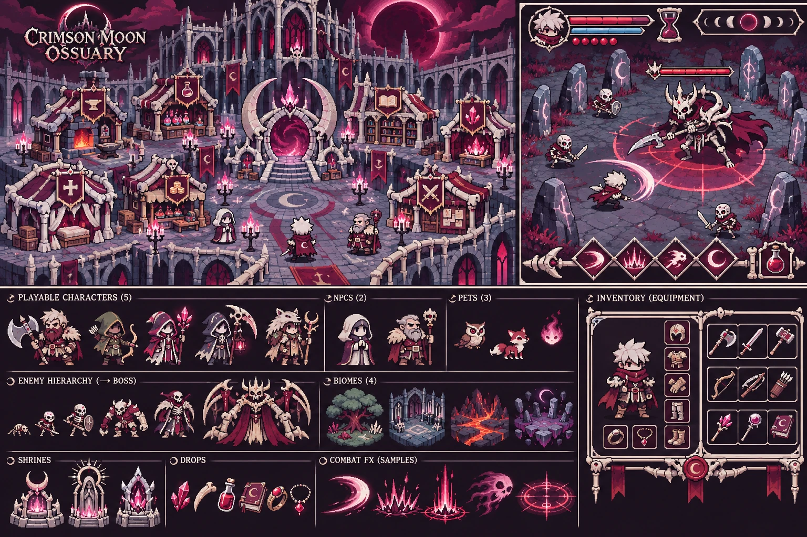
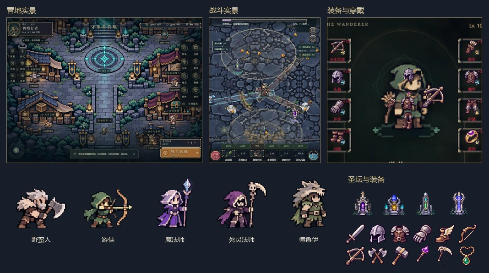

# 《雾隐》整体美术方案

## A · 暮铁守望（已选，游戏内使用）


青色传送门是营地最亮的冷光源，炉火和窗灯提供暖光。人物、装备和怪物用紫灰阴影与深色外轮廓从石墙上分离。旧金留给金属边、按钮和交互点。五名玩家的立绘直接取自设计板的职业栏，去除背景后按实际战斗脚点封装。

## B · 绯月骨庭（备选概念设计）



月蚀是远景焦点。暗红披布、冷银甲片、骨白尖拱与深梅色地面构成基调。旧金铆钉改为骨扣与红蜡封，灯和法阵采用银粉色月光。若采用这版，应同步改变七个服务建筑的轮廓、四种地貌的纹样、职业服装及 HUD 的边角和槽位，保持月蚀图形贯穿整个游戏。

## 两版的完整覆盖范围

| 游戏内容 | A · 暮铁守望 | B · 绯月骨庭 |
|---|---|---|
| 营地、七个服务点与传送门 | 冷青杉林、灰蓝石墙、琥珀招牌和青色石拱门 | 骨白尖拱庭院、绯红遮篷、月牙形传送门及烛台 |
| 150 层秘境、四大主题 | 林地苔石、蓝灰墓砖、含余烬的炭岩、紫脉石板；每主题三种地表 | 枯红根系、骨灰墓砖、血锈火山岩、刻有月相的紫黑方砖 |
| 五职业、穿戴与召唤 | 白发斧手、绿兜帽弓手、紫晶杖法师、骨镰死灵、狼皮德鲁伊；召唤物用残甲骨兵与冰骨法师的轮廓 | 银发红围巾斧手、灰绿猎手、月晶术士、祭袍死灵和狼骨游侠；召唤物佩戴骨扣 |
| 七名 NPC、六种伙伴 | 账簿、晶体、铁锤、钥匙等道具标识职业；猫头鹰、狐和小灵体沿用板上样本 | 记录官用骨笔，遗物守卫托月轮，契约兽用骨白面纹和小块绯红识别色 |
| 24 种怪物、8 位首领、哥布林与训练木桩 | 骨白、石墨铁甲、紫晶法术；杂兵形体紧凑，精英带环，首领放大剪影 | 苍白骨架、暗红软甲和月刃；高阶敌人增加尖拱形肩甲与披风 |
| 圣坛、摆件、掉落与货币 | 青灰石座与独立色芯，金币、进度球、治疗球和装备分形；稀有掉落保留品质光柱 | 骨质碑座和月轮色芯，货币用旧银边与红蜡印记；拾取物保持形状差异 |
| 主副手、五件护甲与饰品 | 钢铁、旧金、皮革和宝石；装备主体保留材质色，系列或专名用右下徽记识别 | 哑银刃、骨柄、绯红系带；专名与套装用月相封印识别 |
| 75 个技能、40 个主动施法图、弹道、地面效果与预警 | 闪电与冰用冷白高光，火用橙金，毒用绿，奥术用紫；危险区域独立描边 | 月光色作为光芯，保留元素副色与不同弹道形状，预警使用红圈、线、扇形 |
| 营地 HUD、背包纸娃娃、锻造、技能、旅程及榜单 | 深青石板、紫灰暗边、旧金角扣，物品卡保留品质色标，正文用浅骨白 | 骨框卡片、酒红蜡封、盾形标题与菱形槽位，正文用浅骨白 |
| 单人/组队 HUD、账号、弹窗及结算 | 同一套边框和按钮材质；血量、能量、冷却和焦点各有独立提示 | 血珠、沙漏、月相进度与骨质角码；保留文字数值和键盘焦点 |

## 实装画面



当前装备页：游侠已穿齐八件装备，中央保留职业原画。


## 接入与核对

角色、伙伴、营地、秘境和战斗图集通过现有载入接口进入游戏。地图按楼层生成布局；十二种材质使用连续边缘的镜像平铺。技能图标按原技能构图逐格限色，施法与地面效果独立保留透明区域。UI 的多尺寸框线使用九宫格角件，文字保持原生渲染。

装备的目录、八个部位、可掉落与预留组合见[装备外观审计](EQUIPMENT_ART.md)。背包、装备槽和地面掉落使用相同外观键，联机接收端也据此选图。五职业在营地、装备页和战斗中均使用完整职业原画，换装不改变人物轮廓。设计板内的英文排版和示意数值仅用于展示方案。

## 主线视觉修订

营地以灰蓝石墙、松林和带铜边的灯具为底。暖金强调出征、当前章关和完成动作，四种地貌的标题条呼应各自色调。场景纹理压低亮度，让战斗角色、紫色进度球和红色预警优先可见。章关地面铺设低亮度的铜灯镶嵌。主线完成后，暖光照入营地，旅程与结局共用同一张归路插画。

内置 ImageGen 生成《归灯》，原图转码为 [watchers-dawn.webp](../public/assets/story/watchers-dawn.webp)，1672 × 941，约 284 KiB。生成提示词如下。

```text
Use case: illustration-story
Asset type: ending illustration for the original Chinese dark-fantasy pixel RPG Mist Continent (雾隐).
Scene: seen from the woods looking toward the Watchers' camp, a broad old blue-gray stone road threads between rows of tall dark pines into a stone archway. In the center foreground an old bronze wayfinding lantern burns brightly. Small echoes of its amber flame light one by one along the road and reach a distant stone watchtower. The mottled blue-green fog that covered the path is breaking apart and the first pale dawn is at the horizon. The environment tells the story, with no visible people.
Style: handcrafted high-detail 2D pixel illustration with clearly legible square pixel clusters, chunky silhouettes, clean stepped edges and restrained dithering. Cold slate, pine green and ink-blue shadows, muted brass, warm honey-orange lamps, a small cyan seam in the old stone arch. A quiet, triumphant payoff, visually related to a moody top-down stone-and-pine fantasy village, with a lower three-quarter cinematic viewpoint.
Composition: wide landscape illustration, main lantern and vanishing point centered through the middle horizontal band. Use the full bleed rectangular canvas, with dark trees as a natural frame. Distinct silhouettes and light pools must remain visible when reduced to a narrow mobile story panel.
Constraints: environment only, no letters, logos, interface, borders, floating text, watermarks, painterly blur or smooth 3D gradients.
```
