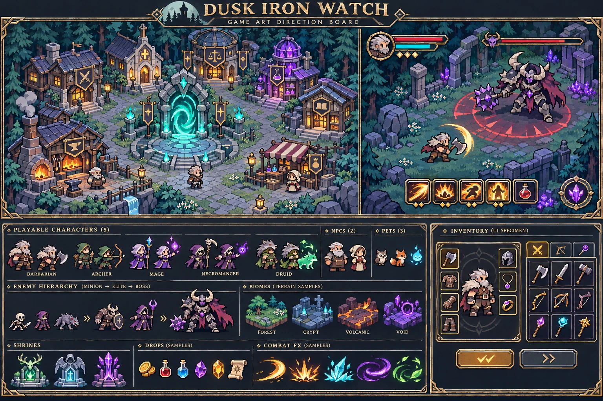

# 《雾隐》整体美术方案

## 精细像素暗黑奇幻

守望者营地建在雾中的山谷边。黑铁拱门、凿刻板岩、铜灯和不同轮廓的建筑用精细像素簇绘制。战场用大块矿物色区分四种地貌，背景纹理压低对比。界面使用石墨、雾蓝和骨白，暖铜强调可执行操作，敌方危险区域使用能与地表分离的描边。

| 内容 | 新版实现 |
| --- | --- |
| 营地与归路 | 内置 ImageGen 独立出图并转码。传送门、七处服务点和角色脚点按新地图定位。雾流、灯光、传送门气流和炉火余烬沿各自时序运动。结局灯火会随背景渐入 |
| 人物、居民与伙伴 | 五职业有独立待机、实跑和施法姿势，七名居民有待机和交互反馈，六类伙伴按位移和技能活动切换姿势。受击、倒地按战斗状态驱动。详见 [人物与伙伴](PAINTED_ACTORS.md) |
| 战场 | 四种地貌及地标、24 种小怪、8 位首领、盗宝者、训练靶、四座圣坛、四种拾取物换用手绘资源。怪物有落脚、蓄势、攻击、受击和退场动作。详见 [战斗美术](PAINTED_BATTLE_ART.md) |
| 技能与装备 | 75 个技能法印、40 张主动施法图与 20 张通用弹道、地面和命中图。231 个装备身份位置使用手绘物件和刻印，背包与掉落共用。装备品质有掉落提示，穿戴、学习、领取与锻造使用各自的界面反馈。详见 [界面美术](UI_ART.md) |
| 危险、音效与音乐 | 敌方预警轮廓在普通特效之上，色弱辅助改变预警描边，治疗瓶与进度晶石的形状不同。营地、远征、首领和结局各有配乐，交互、打击、拾取和圣坛各有声响；托管远征和验证试炼根据新到战斗状态播放反馈 |
| 减少动态 | 跟随系统偏好停用环境和界面的循环装饰，并保留移动、施法状态与危险边界的信息 |

营地 [watchers-keep.webp](../public/assets/maps/watchers-keep.webp) 为 1254 × 1254，668,864 B。结局 [guarded-road.webp](../public/assets/story/guarded-road.webp) 为 1672 × 941，410,624 B。两张使用内置 ImageGen 独立设计新构图，继而按像素画法重绘，保留新地图道路与交互位置匹配。像素成品转为 WebP 后接入地图与剧情接口。

<details>
<summary>两张场景从构图稿到像素成品的完整生成提示词</summary>

```text
Use case: stylized-concept
Asset type: completely original playable town environment painting for 雾隐, a premium hand-painted dark fantasy RPG. This is the final game background, with no characters and no interface.
Subject and composition: a fortified watchpost called the Watchers' Camp, carved into the side of an ancient fog-filled mountain ravine. A tall, asymmetrical north gate made from ribbed blackened iron and rough slate is the focal point, looking down an inner stone stair onto a worn engraved compass plaza. Silver-blue fog breathes through long pine branches outside the walls. An undamaged stone processional path runs south through a narrow guarded archway. Seven genuinely different service structures flank the central footpath, symmetrically navigable but architecturally varied: a half-open scriptoria beneath a short stone arcade upper left; an elevated reliquary with oxidized bronze cases upper right; an iron forge built into a rock overhang middle left; a small records hall with a shuttered brass clock and dark wine canopy middle right; a broad storage building with scaffolding and covered crates lower left; a narrow merchant arcade with roll-down linen lower right; a sheltered pathfinder stable with a lantern by the southern stair on the lower right. No labels or shop-icon signs.
View: continuous nearly square game map, full perimeter visible, fixed top-down three-quarter high overhead camera, no horizon, no foreground objects obscuring walking paths. Leave broad quiet clean paving open between every front entrance and the middle. Approximate normalized ground positions for gameplay: gateway (0.50,0.24), flat paved compass plaza (0.50,0.45), empty central path (0.50,0.52–0.98). Buildings ground doors for scriptorium/reliquary (0.20,0.30 and 0.80,0.30), forge (0.15,0.52), records hall (0.85,0.55), storage (0.22,0.75), merchant (0.84,0.74), stable (0.74,0.87). Place each service's ground aprons for game characters just below these doors. Tall slate roofs and dark perimeter forests mark scene boundaries.
Style: a richly composed authored environment illustration with textured gouache and traditional oil-like brush edges, subtle graphite etching in the architecture and foggy atmospheric depth. Large grouped values and designed silhouettes, hand-crafted joinery, broken tile corners, repaired black iron, sparse bare ornamental stone, a little slate dust and moss. Ground paving mid-low contrast to let actors read. Ink blue, charcoal and mineral green-gray shadows; sharp amber pools around practical lanterns; quiet jade light alone inside the gate. Mature, restrained, distinctly crafted, memorable, premium illustration.
Avoid: pixel art, RPG chibi kit, plastic edges, bright toy colours, glitter and ornate gold UI, fluorescent neon, smooth procedural 3D, photomontage, literal typography, arrows, decorative frame, glowing objects on otherwise walkable paths, or anything that resembles a named existing game's town.
```

```text
Use case: illustration-story
Asset type: wide cinematic narrative art for 雾隐, an original hand-painted dark fantasy role-playing game, for the dawn epilogue.
Scene: seen from a low three-quarter height on a mountain road, the viewer has just stepped out of ancient pine forest into the first dawn. The stone road leads past a single ancient iron watch-lantern in the foreground to a walled watchpost on a rocky rise, with ribbed asymmetrical iron arches and a distant shuttered clock-tower. The lantern in front burns a steady pale amber, with progressively smaller distant lights tracing the walking road through dissipating gray-blue mist. Broken clouds allow a narrow warm line of daylight to catch the wet steps. A modest dark burgundy watch-banner hangs out at the arch. Let the landscape itself express that a safe way home has been restored. No visible people.
Style: authored environmental painting with oils and textured gouache, deliberate values and controlled atmosphere, shaped brush edges, hand-etched medieval stone, oxidized iron, and a little soft graphite grain. Warm ochre light set against mineral blue, greenish slate and charcoal. Strong believable depth. Dark fantasy and quiet hope in equal measure, mature restrained fantasy illustration. Large readable shapes even at narrow mobile screen. Completely independent and original environment.
Composition: extra-wide landscape, 16:9 letterbox framing, main road, primary lantern and arch all within the central 70 percent, full bleed.
Avoid: pixel art, chibi, thick black cartoon outlines, text, buttons, emblems, watermark, saturated gold glow, generic stock castle, photomontage, or a named existing game.
```


```text
Use case: style-transfer
Asset type: full-size navigable map for the original premium 32-bit pixel dark fantasy ARPG 雾隐.
Input image role: exact blockout for camera, geometry, seven entrance positions and paths, and a guide to architectural silhouettes only. Repaint the entire map as authored game-ready pixel art. Preserve the extent of the artwork, north entrance and stair, compass plaza, center footpath and all seven ground doors in their existing positions. Keep the exact square composition.
Style: exceptionally crafted 2D pixel environment, classic 32-bit fantasy console fidelity with a coherent equal-size square pixel grid visible throughout; logically placed 2–4 pixel clusters, confident stepped edges, selective dithering, a deliberately limited palette. Clear large lighting and value groups. Manually designed roofs, iron arch silhouette, masonry, amber window light, cream cloth and scattered desaturated moss. Storm-slate blue-gray stone, dark indigo evergreen foliage, muted mineral jade in the gate and copper/amber practical light. Distinct shadow decks and cliff depth. The central paving is medium value and materially quiet so pixel character sprites can be read. Fewer refined large texture clusters, not busy fine realism. Dark atmospheric fantasy with a distinctive black iron arch and original seven types of service architecture.
Constraints: complete continuous pixel game background, full bleed, not a design-board. No characters, logos, interface, or text. No photographic detail, realism, painted blur or smooth 3D gradients. Avoid blocky 8-bit shapes, harsh outlined cartoon, interchangeable buildings, garish colors and excessive gold decoration. No pixelated filter look. Genuinely hand-authored pixel composition and a strong environmental focal hierarchy.
```

```text
Use case: style-transfer
Asset type: cinematic widescreen ending illustration for an original high-end 32-bit pixel fantasy ARPG. Use the attached layout painting only to retain the hill road, bridge, arch, foreground lantern and distant watcher tower.
Render everything as crafted, full-resolution pixel artwork. One coherent visible square-pixel lattice, individually composed chunky pixel clusters and illustrated hard silhouettes like a carefully lit fantasy console cutscene. Limit ramps to purposeful slate, mineral blue-green and walnut tones, with layered dark pine silhouettes and softened distance defined through flat stepped palettes. The old amber lantern and dawn reflect in a few deliberate clusters along the wet road. Warm orange dusk haze should have hand-placed step bands, not smooth photographic color grading. The foreground light, road and dark ribbed iron arch should read immediately on a 360 px wide phone. Keep a dramatically wide and balanced landscape. Scene hints at travelers coming home without showing people.
Avoid: realism, smooth painted highlights, synthetic filters on an illustration, HDR, photomontage, soft watercolor wash, prose, lettering, watermark, UI, game title, ornamental frame, 3D, or any existing commercial game assets. The whole image should clearly read as authored high-end pixel art.
```
</details>

## 历史版本

### A · 暮铁守望像素版



青色传送门是营地最亮的冷光源，炉火和窗灯提供暖光。人物、装备和怪物用紫灰阴影与深色外轮廓从石墙上分离。旧金留给金属边、按钮和交互点。五名玩家的立绘直接取自设计板的职业栏，去除背景后按实际战斗脚点封装。

### B · 绯月骨庭（备选概念设计）


月蚀是远景焦点。暗红披布、冷银甲片、骨白尖拱与深梅色地面构成基调。旧金铆钉改为骨扣与红蜡封，灯和法阵采用银粉色月光。若采用这版，应同步改变七个服务建筑的轮廓、四种地貌的纹样、职业服装及 HUD 的边角和槽位，保持月蚀图形贯穿整个游戏。

### 两版的完整覆盖范围

| 游戏内容 | A · 暮铁守望 | B · 绯月骨庭 |
|---|---|---|
| 营地、七个服务点与传送门 | 冷青杉林、灰蓝石墙、琥珀招牌和青色石拱门 | 骨白尖拱庭院、绯红遮篷、月牙形传送门及烛台 |
| 150 层秘境、四大主题 | 林地苔石、蓝灰墓砖、含余烬的炭岩、紫脉石板；每主题三种地表 | 枯红根系、骨灰墓砖、血锈火山岩、刻有月相的紫黑方砖 |
| 五职业、穿戴与召唤 | 白发斧手、绿兜帽弓手、紫晶杖法师、骨镰死灵、狼皮德鲁伊；召唤物用残甲骨兵与冰骨法师的轮廓 | 银发红围巾斧手、灰绿猎手、月晶术士、祭袍死灵和狼骨游侠；召唤物佩戴骨扣 |
| 七名 NPC、六种伙伴 | 账簿、晶体、铁锤、钥匙等道具标识职业；猫头鹰、狐和小灵体沿用板上样本 | 记录官用骨笔，遗物守卫托月轮，契约兽用骨白面纹和小块绯红识别色 |
| 24 种怪物、8 位首领、哥布林与训练木桩 | 骨白、石墨铁甲、紫晶法术；杂兵形体紧凑，精英带环，首领放大剪影 | 苍白骨架、暗红软甲和月刃；高阶敌人增加尖拱形肩甲与披风 |
| 圣坛、摆件、掉落与货币 | 青灰石座与独立色芯，金币、进度球、治疗球和装备分形；稀有掉落保留品质光柱 | 骨质碑座和月轮色芯，货币用旧银边与红蜡印记；拾取物保持形状差异 |
| 主副手、五件护甲与饰品 | 钢铁、旧金、皮革和宝石；装备主体保留材质色，系列或专名用右下徽记识别 | 哑银刃、骨柄、绯红系带；专名与套装用月相封印识别 |
| 75 个技能、40 个主动施法图、弹道、地面效果与预警 | 闪电与冰用冷白高光，火用橙金，毒用绿，奥术用紫；危险区域独立描边 | 月光色作为光芯，保留元素副色与不同弹道形状，预警使用红圈、线、扇形 |
| 营地 HUD、背包纸娃娃、锻造、技能、旅程及榜单 | 深青石板、紫灰暗边、旧金角扣，物品卡保留品质色标，正文用浅骨白 | 骨框卡片、酒红蜡封、盾形标题与菱形槽位，正文用浅骨白 |
| 单人/组队 HUD、账号、弹窗及结算 | 同一套边框和按钮材质；血量、能量、冷却和焦点各有独立提示 | 血珠、沙漏、月相进度与骨质角码；保留文字数值和键盘焦点 |

### 历史版实装画面


像素版装备页中的游侠已穿齐八件装备，中央显示以前的职业原画。


### 历史版接入与核对

角色、伙伴、营地、秘境和战斗图集通过现有载入接口进入游戏。地图按楼层生成布局；十二种材质使用连续边缘的镜像平铺。技能图标按原技能构图逐格限色，施法与地面效果独立保留透明区域。UI 的多尺寸框线使用九宫格角件，文字保持原生渲染。

装备的目录、八个部位、可掉落与预留组合见[装备外观审计](EQUIPMENT_ART.md)。背包、装备槽和地面掉落使用相同外观键，联机接收端也据此选图。

### 四地貌战场

本轮四张战场底图分别为[密林](../public/assets/maps/painted/forest-arena.webp)、[墓园](../public/assets/maps/painted/crypt-arena.webp)、[熔炉](../public/assets/maps/painted/ember-arena.webp)和[圣殿](../public/assets/maps/painted/void-arena.webp)。内置 imagegen 生成 2 × 2 完整场景后逐象限切为 627 × 627 WebP。运行时只加载本层的一张，按近邻像素采样覆盖战场，叠加场景交互物、敌人和预警。

<details>
<summary>四地貌战场图集的生成提示词</summary>

Single production environment atlas for an original premium 2D pixel-art dark fantasy ARPG. Square, exactly 2 columns by 2 rows of full square outdoor arenas touching edge to edge without margins or lines. Each cell is ONE continuous environment, carefully composed as a whole rather than a repeating tile. Top left: an overgrown old royal forest path, tufts of muted sage and ferns, leaf litter, long shale stepping stones, roots and tree silhouettes at outer edges. Top right: ruined cloister cemetery, offset irregular old blue-gray flagstones, moss and fallen petals, outer edges hint at broken sepulchral colonnades. Bottom left: ochre-black abandoned volcanic foundry basin, jagged cooled basalt plate veins, small ember-red fissures thinly crossing the floor, clinker gravel, scattered charcoal, battered grated channels along edges. Bottom right: a violet-gray ancient astral sanctuary, hand-chiseled stone paving interrupted by soil, fragments of a worn incomplete celestial inlay and broken plinths along the edges. Every environment has a broad open traversable center, with asymmetrically meandering paths, low contrast terrain especially in the center, a few islands of fine detail, shallow grounding shadows, strongest environment detail at the outer fifth. Top-down three-quarter overhead looking down almost vertically with consistent light from upper left. Use pixel clusters with stair-stepped edges and restrained 24-color ramps, distinctly hand-pixeled 1990s 16-bit fantasy RPG environment art, dark mineral shadows and old copper highlights, precise graphic shapes readable in the game. Wide-scale overhead view covers a whole arena roughly 20 screens of character widths, small gravel and flagstones rather than boulders the size of a character. Each quadrant has all four edges, no horizon, no drop shadows between cells, no unpainted space, no labels, no text, no borders, no sprites, no humanoids, no enemies, no treasures, no elevated buildings, no central icon, no burning furnace model, no central logo or spotlight. No perfect mirrored textures, no repeated tiles. Full bleed square atlas.

</details>

### 五职业持械外观

游侠持晨哨手弩、野蛮人持方锤、法师持暮星秤杖、魂灵师提逆潮灯、德鲁伊持绿炉裂影匕时，营地、装备预览、战斗和队友所见的角色会换为对应的持械画。普通职业战锤与冥灯也复用匹配的持械形状。其他携行装备仍沿用职业形象。把装备放在背包或仅在魔盒启用其力量，均不会切换人物图。

内置 imagegen 根据五职业的 5 × 3 姿势参考生成[持械像素原画](art/painted-actors/equipped-atlas.webp)。用 `pnpm exec tsx scripts/prepare-painted-actors.ts --equipped` 处理为 15 个 128 × 128 的透明 WebP，脚底位于第 124 行。营地使用站立与跑步两种构图，战斗通过骨骼网格驱动，减少动态时使用静态出手图。

<details>
<summary>持械图集的生成提示词</summary>

Use case: precise-object-edit. One production pixel-art character animation atlas for a dark fantasy Chinese ARPG. Reference/edit target is the supplied 5-column by 3-row sprite contact sheet. Keep the exact same five people, clothing, hairstyles, class colors, poses, pixel clusters, face direction, height and foot anchors, but replace their held equipment clearly in ALL three rows. Column 1 teal ranger uses a substantial etched bronze horizontal crossbow with visible stock, limbs and bolt held across the body or aiming right, no vertical longbow. Column 2 fur-cloaked heavy warrior holds a heavy square iron-headed two-handed warhammer with bronze bands, no axe. Column 3 purple arcanist holds a pale brass long wizard staff capped with a bright orange-red sun in an open bronze cage, no purple diamond. Column 4 dark necromancer keeps bone scythe in leading hand and prominently carries a blue-green glowing iron hanging lantern in the other hand, separately readable next to waist. Column 5 druid keeps the wolf pelt and carries two conspicuous long pale jade hooked daggers. Each held weapon present in all three frames of its own column. Exactly fifteen detached full body sprites centered in fifteen equal cells. Top row feet planted in 3/4 standing pose, middle row running right, bottom row distinct attacking right. Empty safe gutters around every figure, all hands feet weapons visible, no overlaps between cells, no text, no grid, no solid panel, no ground shadows. Pixel-perfect 16-bit hand-pixeled clusters, tiny directional highlights, limited muted palette, genuine transparent alpha outside each silhouette. Landscape 5:3 atlas. Match the source art at in-game 128px.

</details>

### 历史版主线视觉修订

营地以灰蓝石墙、松林和带铜边的灯具为底。暖金强调出征、当前章关和完成动作，四种地貌的标题条呼应各自色调。场景纹理压低亮度，让战斗角色、紫色进度球和红色预警优先可见。章关地面铺设低亮度的铜灯镶嵌。主线完成后，暖光照入营地，旅程与结局共用同一张归路插画。

历史像素版《归灯》由内置 ImageGen 生成，归档图片为 [watchers-dawn.webp](art/legacy-maps/watchers-dawn.webp)，1672 × 941，约 284 KiB。

```text
Use case: illustration-story
Asset type: ending illustration for the original Chinese dark-fantasy pixel RPG Mist Continent (雾隐).
Scene: seen from the woods looking toward the Watchers' camp, a broad old blue-gray stone road threads between rows of tall dark pines into a stone archway. In the center foreground an old bronze wayfinding lantern burns brightly. Small echoes of its amber flame light one by one along the road and reach a distant stone watchtower. The mottled blue-green fog that covered the path is breaking apart and the first pale dawn is at the horizon. The environment tells the story, with no visible people.
Style: handcrafted high-detail 2D pixel illustration with clearly legible square pixel clusters, chunky silhouettes, clean stepped edges and restrained dithering. Cold slate, pine green and ink-blue shadows, muted brass, warm honey-orange lamps, a small cyan seam in the old stone arch. A quiet, triumphant payoff, visually related to a moody top-down stone-and-pine fantasy village, with a lower three-quarter cinematic viewpoint.
Composition: wide landscape illustration, main lantern and vanishing point centered through the middle horizontal band. Use the full bleed rectangular canvas, with dark trees as a natural frame. Distinct silhouettes and light pools must remain visible when reduced to a narrow mobile story panel.
Constraints: environment only, no letters, logos, interface, borders, floating text, watermarks, painterly blur or smooth 3D gradients.
```
